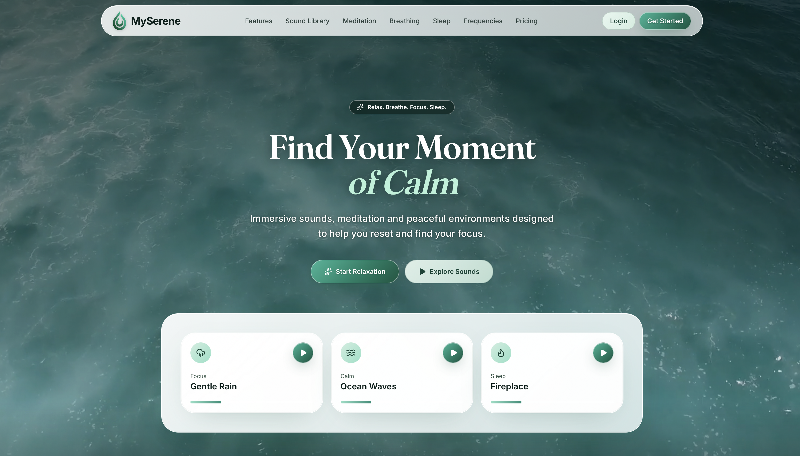
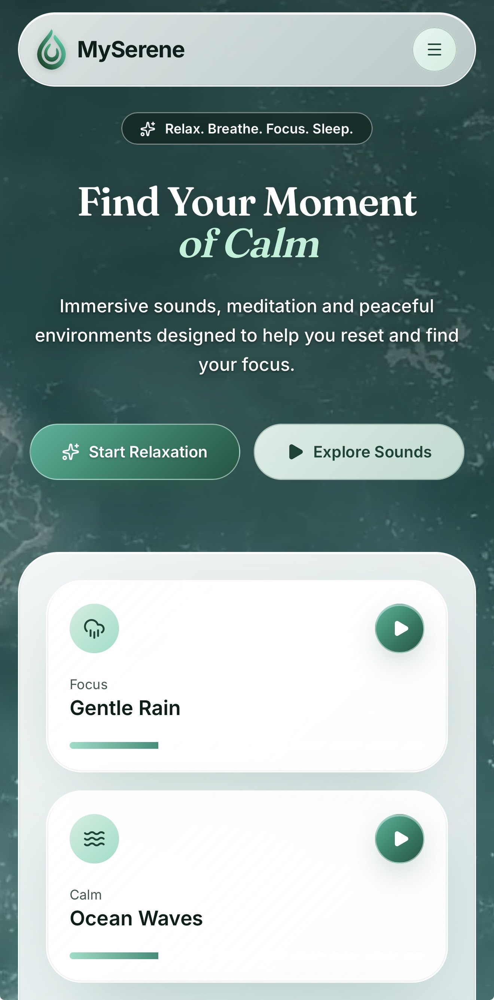
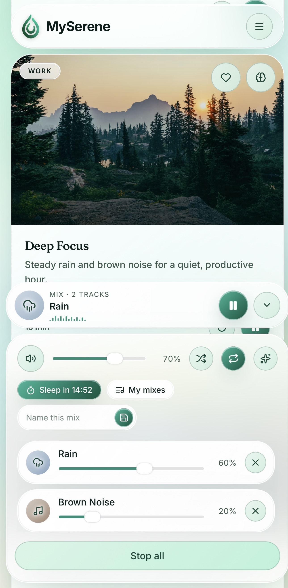

# My Serene

### A digital sanctuary for calm, focus, and mindful moments.

🌐 **Live Demo:** [https://my-serene.netlify.app](https://my-serene.netlify.app)

My Serene is an immersive web application designed to help create a calm environment for relaxation, focus, breathing, and mindful moments.

The project combines a minimal glass-inspired interface, nature-inspired visuals, procedural ambient audio, and mobile-friendly interactions to create a peaceful digital experience.

## Preview



### Mobile Experience



### Ambient Audio Interface



## ✨ Features

- 🌊 **Immersive nature-inspired experience** - calming visuals and atmospheric backgrounds.
- 🎧 **Procedural ambient audio** - soundscapes generated directly in the browser using the Web Audio API.
- 🎚️ **Audio mixing** - individual volume controls for different ambient sound layers.
- 🧘 **Relaxation experience** - designed for breathing, relaxation, focus, and quiet moments.
- 📱 **Responsive design** - optimized for desktop, tablet, and mobile devices.
- 🔒 **Background playback support** - designed to continue audio playback when Safari is running in the background on supported iOS devices.
- 🎛️ **Media Session integration** - provides playback controls through supported Lock Screen and Control Center interfaces.
- ⚡ **Lightweight audio architecture** - ambient sounds are generated in the browser instead of relying on hosted audio files.

## 🛠 Tech Stack

- **React**
- **TypeScript**
- **TanStack Start**
- **Tailwind CSS**
- **Web Audio API**
- **Media Session API**
- **Netlify**

## 🎧 Audio Architecture

The ambient audio engine uses the browser's **Web Audio API** to generate and mix sound in real time.

Instead of hosting individual audio files, the application creates procedural sound layers directly in the browser. This makes the audio system lightweight and allows different sounds to be combined and controlled independently.

The audio system includes:

- Real-time sound generation
- Individual volume controls
- Multiple ambient layers
- Continuous soundscapes
- Browser-based audio mixing
- Media Session integration

The Media Session API is used to expose playback controls through supported system interfaces.

Supported actions include:

- Play
- Pause
- Stop
- Next track
- Previous track

Seek functionality is intentionally not used because the ambient soundscapes are continuous experiences rather than traditional finite audio tracks.

### iOS Background Playback

My Serene uses a hidden `HTMLAudioElement` together with the Media Session API to help maintain a media session on supported iOS devices.

Background playback can still be affected by browser and operating-system policies, memory pressure, or another application taking audio focus. When this happens, playback can be re-armed when the user returns to the application or interacts with it again.

## 📱 Responsive Experience

The interface was designed with mobile interaction in mind while remaining fully responsive on larger screens.

The application adapts to:

- iPhone and other mobile devices
- Tablets
- Desktop browsers

The goal is to keep the experience simple and uncluttered regardless of screen size.

## 🚀 Getting Started

### Prerequisites

Make sure you have installed:

- Node.js
- npm
- Git

### Clone the repository

```bash
git clone <your-repository-url>
cd <repository-name>
```

### Install dependencies

```bash
npm install
```

### Start the development server

```bash
npm run dev
```

The local development server will provide the URL in the terminal.

## 🔍 Development Checks

Build the application:

```bash
npm run build
```

Run the TypeScript check:

```bash
npx tsc --noEmit
```

Run linting:

```bash
npm run lint
```

## 🌐 Deployment

The application is deployed on **Netlify**.

### Live Website

**https://my-serene.netlify.app**

The project uses the existing `netlify.toml` configuration for the production build and server-side rendering.

The deployment configuration includes:

- `npm run build` as the production build command
- `dist` as the publish directory
- Netlify server-side rendering configuration
- Static asset handling
- Deep-link routing support

The optional `VITE_SITE_URL` environment variable can be used to define the canonical production URL for absolute social preview URLs.

## 📂 Project Structure

The repository contains the main application source code together with the project documentation and visual previews.

```text
my-serene/
│
├── README.md
├── screenshots/
│   ├── preview.png
│   ├── mobile.png
│   └── audio-controls.png
│
├── src/
├── public/
├── package.json
├── netlify.toml
└── ...
```

## 🎯 Project Goals

My Serene was created to explore how modern web technologies can be used to build a calm and immersive digital environment.

The project focuses on:

- Minimal interface design
- Mobile-first interaction
- Browser-based audio
- Real-time sound generation
- Media Session capabilities
- Responsive web development
- Performance-conscious implementation

## 🔮 Future Development

Possible future improvements include:

- Additional nature-inspired soundscapes
- More advanced audio mixing
- Personalized sound combinations
- Additional breathing and relaxation experiences
- Improved accessibility
- More detailed user preferences

## 📄 License

No open-source license has been specified for this project.

All rights and permissions remain with the copyright holder unless a separate license is added to the repository.

---

### My Serene

**Find your moment of calm.**

🌐 https://my-serene.netlify.app
